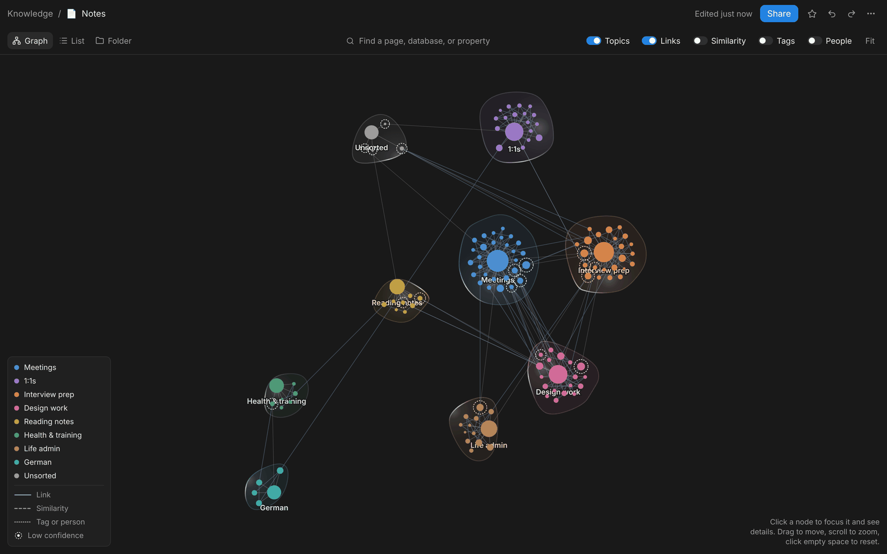
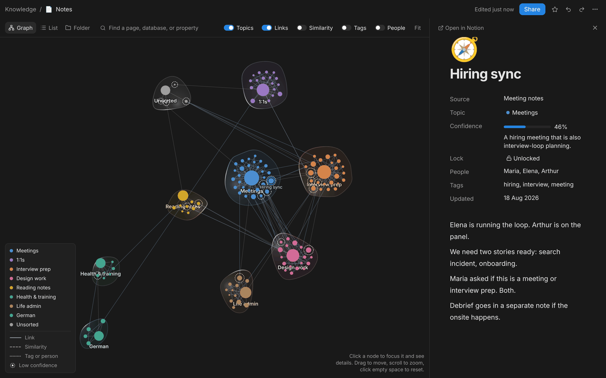
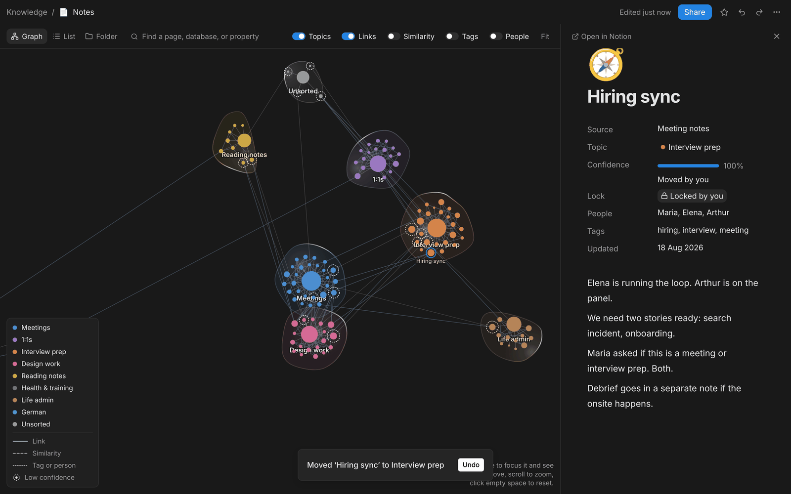

# Knowledge Atlas

**The question:** what if the way an AI sorted your notes were something you could
see, question and overrule, and the AI then left your correction alone?

[Live demo →](https://denys-knowledge-atlas.vercel.app)



*Graph: 120 notes the AI sorted into nine topics. A dashed ring marks the notes it isn't sure about.*



*Peek: "Hiring sync" sits in Meetings at 46%. The reason is a sentence, not just a number.*



*Correct: one move and the note reads "Moved by you" and "Locked by you". Undo is one click away.*

## What it is

A dark, Notion-like page for a pile of notes. The page is the database. Graph, List and
Folder are three views of the same notes, not three pages, so a correction made in one
shows up in all of them.

**See.** The Graph draws each topic as a cluster with a hub. Notes link to the notes
they mention. Layers for similarity, shared tags and shared people can be switched on
when you want them.

**Question.** Click any note and a side peek opens with its topic, a confidence bar,
and the AI's reason in plain words. The map keeps the rest of the width.

**Overrule.** Drag a note into another cluster, or pick a topic from the peek. Drag
one topic hub onto another to merge them. Every change can be undone with ⌘Z or from
the toast.

## The decision moment

Most tools that "organize your workspace" show you the result and hide the reasoning.
Folders appear, and you can't tell which placements were obvious and which were
guesses. The only way to find a bad one is to stumble on it.

This prototype designs the other version. Every placement carries a confidence and a
reason:

> A hiring meeting that is also interview-loop planning.

The note sits in Meetings at 46%. Read the sentence and you know why it's unsure and
where else it might belong, and you can decide in a second.

## Four decisions I'd defend

**1. Doubt is drawn on the map.**
Notes under 60% confidence get a dashed ring. You can see where to look before you
open anything: 18 of 120 notes, not a review queue of all 120.

**2. A correction outranks the model.**
A note you move becomes *Moved by you*, at 100%, and locked. The prototype has no
re-sort pass yet, but the rule is already in the data (`origin: 'user'`,
`locked: true`). The next AI pass would have to leave that note alone. An assistant
that quietly undoes your fixes teaches you that fixing was pointless.

**3. Unsorted is a topic, not a failure.**
Notes with thin titles and no links go to Unsorted, with a reason:
*"Thin title and no clear home, so it stays in Unsorted."* An honest "I don't know"
is more useful than a confident wrong folder.

**4. Only small groups get a line.**
Tag and people edges are drawn only when two to six notes share the value. "meeting"
or "Maria" would connect half the map and turn it into a hairball. A line should mean
something.

## What I found by building it

Moving one note re-settles the whole map. The clusters drift, and the one you were
looking at isn't where you left it. The correction costs you your place on the map.
A static comp could not have shown me that, because nothing in a static comp moves.

## Deliberately not built

Notion sync · real model calls · an AI re-sort pass · creating, renaming or nesting
topics from the UI · editing note text · sharing · a phone layout.

The data actions for topics exist; the controls don't. "Share" and "Open in Notion" are
set dressing. None of these helps answer the question above.

## What I'd test next

Two things. First, whether people trust a 46% more when it comes with a sentence, or
whether they just read the sentence and ignore the number.

Second, what a re-sort looks like once some notes are locked. The AI moves everything
else around your corrections, and the map has to stay still enough that you can see
what changed.

## Using it

| View   | What it shows |
| ------ | ------------- |
| Graph  | Clusters of notes. Drag a note into another topic to correct the AI. Drag a topic hub onto another to merge them. Double-click a pinned note to release it. |
| List   | Every note as a row: name, topic, updated date. |
| Folder | Each topic as a folder. Open one to see its notes. |

Search in the bar filters the current view, and ⌘K opens the same search. ⌘Z undoes a
move or merge. Esc closes the peek or the menu. The ··· menu has source filters
(Meeting notes, Docs, Journal, Wiki, Tasks) and **Reset demo**.

`data/seed.ts` has 120 notes and `data/seedAssignments.ts` sorts them into nine topics.
Edges are derived when the graph is built, not stored. Your corrections live in this
browser only (localStorage), and Reset demo restores the seed.

## Running it

```bash
pnpm install
pnpm dev
# → http://localhost:3000

pnpm test
pnpm lint
```

Built in my own time. Fake data throughout, no production code and nothing proprietary,
just enough to feel the interaction.

## Built with


## Live demo

Try it at [denys-knowledge-atlas.vercel.app](https://denys-knowledge-atlas.vercel.app)
